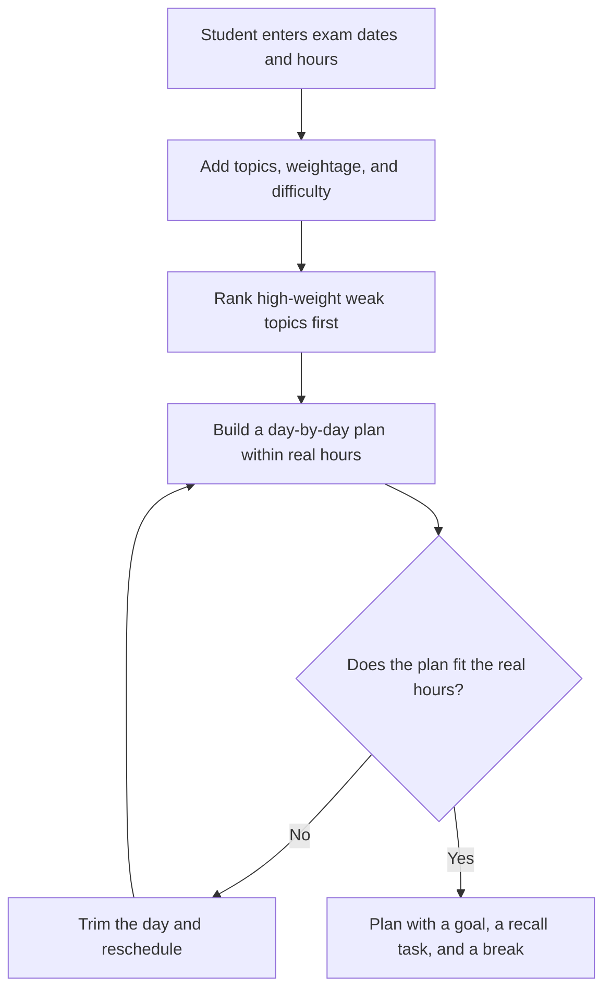
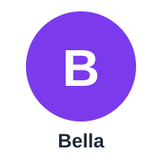

# Personalised Study Planner

## An AI Learning Product

A study planner that fits a student's real life — not a generic timetable.

Most students do not fail because they have no study material. They fail because they have limited time, and they spend it in the wrong places. They study the topics they already know, and they run out of time for the topics that carry the most marks and feel the hardest.

This project designs a planner that fixes that problem. It takes a student's exam dates, syllabus weightage, personal difficulty, and real available hours, and it produces a day-by-day plan the student can actually follow.

**Level:** Builder–Practitioner
**After Phase:** Phase 06
**Type:** Academic AI Product Manager project

## What makes this project unique

This is the only project in the set that answers nothing — it **allocates scarce time**. Its subject is not knowledge, but trade-offs: which topic deserves the next hour, and which one can wait. Its hardest failure is a beautiful plan that demands more hours than the student actually has; that plan fails automatically, however clever it looks. Its key measure is not hours studied, but 100% coverage of high-weight topics before the exam, checked by adherence after 7 days. Bella, the example student in the story below, works hard yet studies the subject she already knows while her weakest, highest-mark subject waits — the exact misallocation this planner is built to fix.

---

## The problem in one paragraph

Student failure rarely comes from lack of material. It comes from poor allocation of limited study time across subjects with different exam dates, weightage, and personal difficulty.

Generic timetables ignore all three. So students over-study comfortable topics and arrive unprepared in high-weight, weak areas.

The Personalised Study Planner solves this by planning around what matters most, when it matters most, and how much time the student really has.

---

## Why it matters

- **Time is limited.** A student cannot study everything equally. Choices have to be made.
- **Exams are not equal.** Some papers carry more marks. Some are sooner. Some topics are harder for that student.
- **A plan that does not fit real life is not a plan.** If it asks for 8 hours on a day when the student has 3, it will be ignored.
- **Good planning reduces stress.** When a student can see that the whole syllabus is covered before the exam, preparation feels possible.

This is a planning aid. It does not give medical or mental-health advice, and it does not guarantee marks. The student can override any day.

---

## What the product does

### Inputs

The student provides:

1. Exam dates
2. Syllabus topics and their weightage
3. Self-rated difficulty for each topic
4. Available hours per day
5. Fixed commitments — classes, work, family, travel

### Output

A day-by-day plan with, for each day:

- Topic to study
- Goal for that session
- A recall task — a short test of what was learned, from memory
- A break

### In scope

- Planning a study schedule
- Rescheduling when life changes — illness, a missed day, a new commitment

### Out of scope

- No medical or mental-health advice
- No guarantee of marks
- No counselling

The student is always in control and can override any day.

---

## How it works



`docs/09-diagrams.md` shows the same trade-off visually: rank the high-weight weak topics first, build the plan inside real hours, trim it when it does not fit.

## The story



Bella spends most of her time on psychology, the subject she already knows, and runs out of time for statistics, her weakest subject with the most marks. With the planner, her high-weight weak topics come first, in a plan that fits her real hours and can be rescheduled when life changes. Read the full story in [docs/10-story.md](docs/10-story.md).

## How to use this project

Start with a chat tool, the documents, and the test sets — no software build is needed, because the work here is deciding what a good plan is and proving it with 12 scenarios.

### Step 1 — Read the problem

Start with `docs/01-problem-statement.md`. It explains the problem and the evidence for it.

### Step 2 — Read the research

Read `docs/02-research-notes.md`. It contains the interview plan for 5 students and a template for recording what you learn. Do the interviews yourself — do not invent answers.

### Step 3 — Read the spec

Read `docs/03-spec.md`. It is the one-page specification: what the planner takes in, what it produces, what is in scope, and what is out of scope.

### Step 4 — Run the evals

Open `evals/eval-set.csv`. It contains 12 planner scenarios. Use them to test a plan before you trust it.

The rule is simple: **any plan that asks for more hours than the student really has fails automatically.**

Read `docs/04-eval.md` for the rubric and for how to record results. The result column in the CSV is left blank / TBD on purpose. Fill it in only after you have actually run a test.

### Step 5 — Measure what matters

Read `docs/05-metrics.md` for the metrics plan, `docs/06-cost-latency.md` for the cost and latency trade-off, and `docs/07-risks-guardrails.md` for the risks and guardrails.

### Step 6 — Release in stages

Read `docs/08-release-portfolio.md`. It explains the pilot with 5 students for one full exam cycle, the weekly check-ins, and what must be true before releasing to a full class.

---

## Project structure

```text
personalised-study-planner/
├── README.md
├── .gitignore
├── docs/
│   ├── 01-problem-statement.md
│   ├── 02-research-notes.md
│   ├── 03-spec.md
│   ├── 04-eval.md
│   ├── 05-metrics.md
│   ├── 06-cost-latency.md
│   ├── 07-risks-guardrails.md
│   ├── 08-release-portfolio.md
│   ├── 09-diagrams.md
│   └── 10-story.md
├── assets/
│   └── avatar-bella.svg
└── evals/
    └── eval-set.csv
```

---

## Portfolio proof

This project proves product management skill through evidence, not claims. The proof is:

1. **Research insights** — from interviews with 5 real students (see `docs/02-research-notes.md`).
2. **12-scenario eval table** — with a clear rubric and a hard fail rule (see `docs/04-eval.md` and `evals/eval-set.csv`).
3. **Before / after plan for one real student** — anonymised, showing the generic timetable they used before and the personalised plan after (see `docs/08-release-portfolio.md`).
4. **Pilot metrics** — adherence after 7 days, coverage, reschedule rate, time and cost per plan (see `docs/05-metrics.md` and `docs/08-release-portfolio.md`).
5. **Iteration after week 1 feedback** — what changed in the product after the first week of the pilot, and why (see `docs/08-release-portfolio.md`).

All example data, example scenarios, and template interview questions in this project are labelled EXAMPLE / template. Blank results tables are provided to fill in with real results. No fake results and no fake user quotes are presented as real.

---

## Primary metric

**Syllabus coverage completed before the exam + self-reported preparedness.**

A good plan is one the student can follow, that covers 100% of high-weight topics, and that leaves the student feeling prepared — not just busy.
