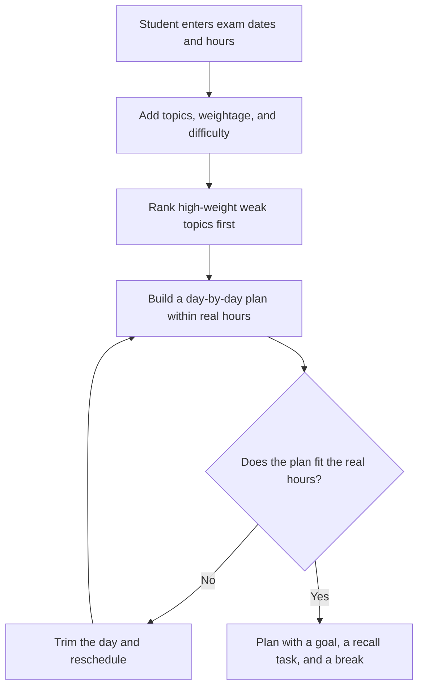
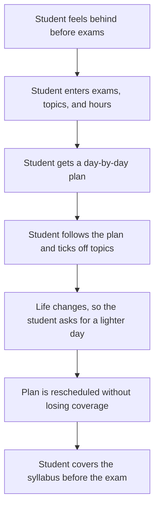
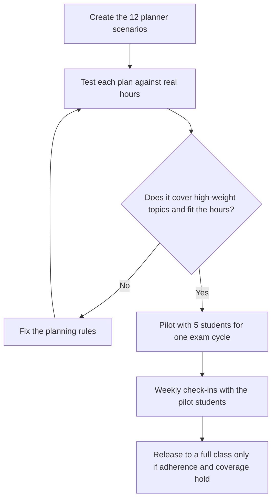

# Diagrams — Personalised Study Planner

These are simple diagrams to help a beginner see how the product works. They match the spec in `docs/03-spec.md`. No image files are used — the diagrams below are written in Mermaid text, which GitHub renders as a picture.

## 1. How it works

What this shows: the plan is built around what matters most and how much time the student really has. A plan that asks for more hours than the student has fails automatically.

## 2. User journey

What this shows: before the product, the student studied easy topics first and ran out of time. After it, the student studies the right topics first and can change the plan when life changes.

## 3. Eval and release flow

What this shows: the planner is tested on hard cases first — short time, clashing exams, a part-time job — and only released to a class after a real pilot works.
